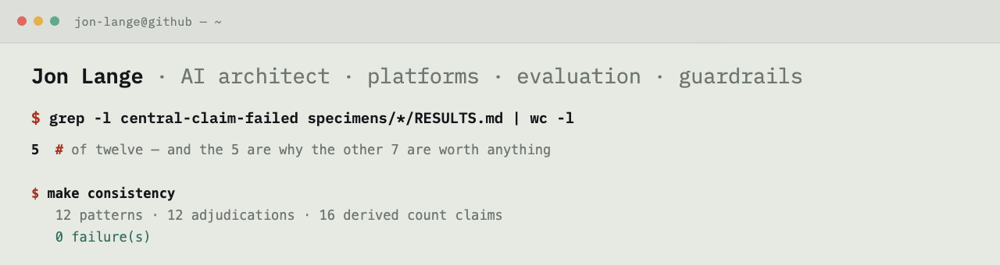

<picture>
  <source media="(prefers-color-scheme: dark)" srcset="assets/banner-dark.png">
  
</picture>

**Senior Director, AI @ Ripple.** I turn AI vision into customer-facing features,
and I care just as much about the teams and processes that make that speed
sustainable. Most of the work is production discipline — the part that separates
a system you can put in front of customers from an impressive demo.

Before Ripple: eight years at GTreasury through the acquisition, from DevOps
Analyst to Principal AI Solutions Architect. I built the platform before I built
the AI on top of it.

[](https://jon-lange.github.io/)
[](https://www.linkedin.com/in/jonathan-lange-ai-architect/)
[](https://x.com/langej117)

---

### `~/` what I work on

```console
$ cat ~/context-engineering/dimensions
1  data inputs
2  prompt engineering
3  model selection
4  workflow architecture
5  evaluation pipelines       <- measured, 12 specimens
6  continuous monitoring      <- measured, 12 specimens

$ # all six now carry a module. two measured, four demonstrated.
```

Enterprise AI architecture built compliance-first · LLMOps · RAG and agent
systems · IaC, CI/CD and the unglamorous foundations underneath.

---

### `~/` [not-evidence](https://github.com/jon-lange/not-evidence) — twelve signals that look like evidence and aren't

The guardrail that refused the obvious attack. The green test that never ran. The
judge that shares the subject's lineage. The label that says "sanitized."

Every entry was written as a claim, put in front of real models or a real
adversary, then rewritten to whatever came back.

```console
$ make check
  12 patterns · 12 adjudications · 16 derived count claims
  12 falsification conditions · 208 relative links
  0 failure(s)

$ python3 tools/mutcheck.py --demo
  redaction works                    CAUGHT
  rollout flag off                   NOT CAUGHT   <- the assertion was never watching
  schema change dropped the field    NOT CAUGHT   <- same
```

| | |
|---|---|
| **All twelve measured** | seven survived · five had their central claim fail |
| **Bounded** | twelve entries, then finished |
| **No borrowed numbers** | nothing appears that was not generated there |

```bash
/plugin marketplace add jon-lange/not-evidence   # five eval checks, each with its measurement
```

<details>
<summary><b>Why the failures are the point</b></summary>

<br>

A catalogue where everything confirmed would read as confirmation bias, and any
sharp reader would assume the tests were shaped to pass. The five that failed are
what make the seven credible.

The comparison worth making is not against a catalogue whose claims all held. It
is against the usual case, where nobody ran them.

</details>

---

### `~/` [field-tested](https://github.com/jon-lange/field-tested) — building blocks that say how you know they work

```yaml
proof: measured    # a figure, and the specimen that produced it
proof: tested      # a runnable test in this repository
proof: demo        # a runnable demonstration
proof: unproven    # declared as such, with what would prove it
```

`unproven` is the load-bearing one. You may publish something you have not
validated. You may not publish it looking validated. A script enforces it.

Six training modules, one per dimension, 45-60 minutes each and none needing an
API key. Each hands you something green that is lying and asks you to find out
how before showing you.

```console
$ ls training/
01-evaluation      is your eval suite telling the truth?
02-monitoring      is your dashboard?
03-data-inputs     is what reaches the model what you think?
04-prompting       did your prompt really improve?
05-model-selection are those two models interchangeable?
06-workflow        what did your pipeline actually do?
```

Two are `measured` and four are `demo` — the frontmatter says which, rather than
letting a full grid imply otherwise.

---

### `~/` how I publish

Working in a regulated industry usually means publishing nothing. I wrote down
the discipline that makes it possible instead — six rules, enforced by hooks and
CI rather than by remembering, including the one that matters most: **no number
appears that was not generated here.**

→ **[METHOD.md](https://github.com/jon-lange/not-evidence/blob/main/METHOD.md)**

---

### `~/` what I'd like to hear about

**A result that contradicts one of the twelve.** Every specimen states what would
falsify it, and a contradicting measurement gets the entry rewritten and you
credited in it. That is not a courtesy — a catalogue whose claims were only ever
checked by their author is a catalogue of one person's confidence.

<sub>Greater Chicago Area · CSM · CSPO · views my own</sub>
